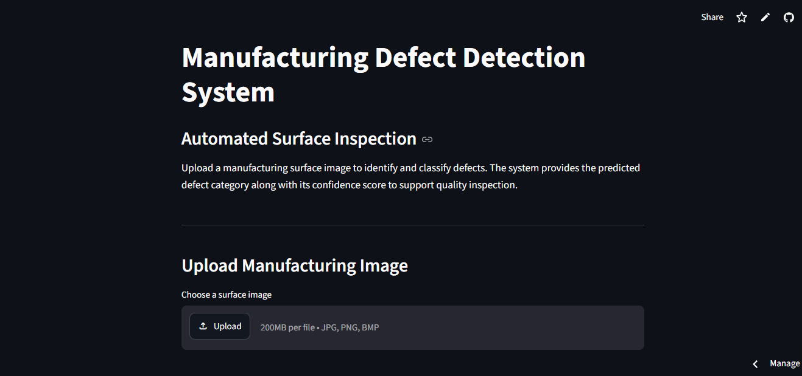
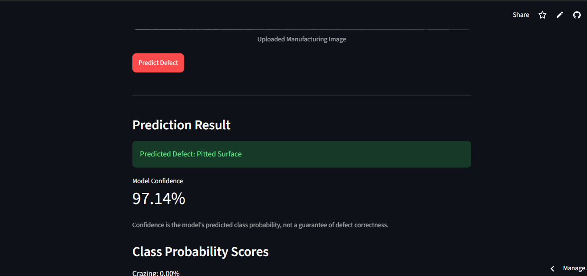
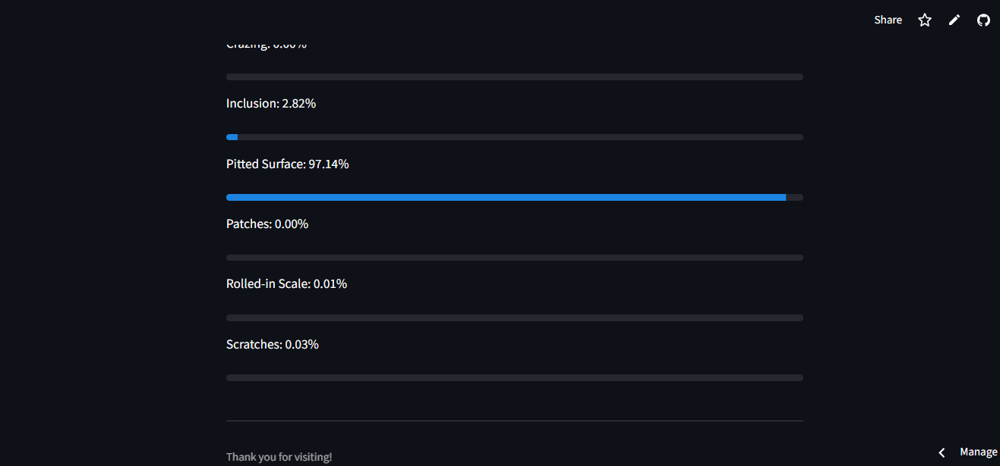

# Manufacturing Defect Detection System

A deep learning-based application for detecting and classifying manufacturing surface defects using image analysis.

The system uses a custom Improved Convolutional Neural Network (CNN) implemented in PyTorch to classify steel surface images into six defect categories. It provides predicted defect labels and confidence scores through an interactive Streamlit web application.

## Live Application

[Manufacturing Defect Detection System](https://cnn-defect-detection-manufacturingprocess.streamlit.app/)

## Project Overview

Surface defects in manufacturing can affect product quality and reliability. Identifying these defects through visual inspection can be time-consuming.

This project focuses on automated surface defect classification using deep learning. The trained CNN analyzes uploaded manufacturing images and predicts the corresponding defect category.

The application provides an interactive interface for image-based defect prediction and confidence score visualization, supporting surface inspection and quality analysis.

## Application Screenshots

### 1. Application Interface

The application provides an interface for uploading manufacturing surface images for defect classification.



### 2. Defect Prediction

The trained CNN predicts the defect category and displays the model's confidence score.



### 3. Class Probability Scores

The application displays probability scores for all six defect categories, allowing users to view the model's predictions across different classes.



## Project Objectives

- Develop an improved Convolutional Neural Network (CNN) for automated classification of six manufacturing surface defect categories using the NEU-CLS dataset.
- Evaluate the model's classification performance using accuracy, precision, recall, F1-score, and confusion matrix analysis to identify its strengths and misclassification patterns.
- Integrate the trained model into a Streamlit application that enables users to upload surface images, obtain defect predictions, and visualize class-wise confidence scores.

## Technologies Used

| Technology | Purpose |
|---|---|
| Python | Model development and application |
| PyTorch | CNN implementation and training |
| Torchvision | Image preprocessing and transformations |
| NumPy | Numerical operations |
| Pandas | Data analysis and result processing |
| Matplotlib | Training and evaluation visualizations |
| Scikit-learn | Classification metrics |
| Streamlit | Interactive web application |

## Dataset

**Dataset:** NEU-CLS Steel Surface Defect Dataset

The dataset contains grayscale steel surface images belonging to six defect categories.

| Defect Code | Defect Category |
|---|---|
| Cr | Crazing |
| In | Inclusion |
| Pa | Pitted Surface |
| PS | Patches |
| RS | Rolled-in Scale |
| Sc | Scratches |

The dataset is organized into training, validation, and testing subsets.

The model processes grayscale images resized to 200 × 200 pixels.

## Model Architecture

The project uses a custom Improved CNN architecture implemented in PyTorch.

### Architecture Components

- Four convolutional blocks
- Batch normalization
- ReLU activation
- Max pooling
- Fully connected classification layer
- Dropout for regularization
- Six-class output layer

The model processes grayscale images resized to 200 × 200 pixels.

### Training Configuration

| Parameter | Value |
|---|---|
| Image Size | 200 × 200 |
| Batch Size | 16 |
| Maximum Epochs | 25 |
| Optimizer | Adam |
| Initial Learning Rate | 0.0003 |
| Loss Function | Cross-Entropy Loss |
| Weight Decay | 0.0001 |
| Learning Rate Scheduler | ReduceLROnPlateau |
| Early Stopping Patience | 6 |

The model was trained using the available GPU or CPU environment.

## Model Performance

The trained model achieved the following results on the held-out test dataset containing 276 images.

### Test Results

| Metric | Result |
|---|---:|
| Test Accuracy | 96.38% |
| Correct Predictions | 266 |
| Incorrect Predictions | 10 |
| Total Test Images | 276 |

### Evaluation Metrics

The model was evaluated using the following classification metrics:

| Metric | Score |
|---|---:|
| Weighted Precision | 96.41% |
| Weighted Recall | 96.38% |
| Weighted F1-Score | 96.37% |

Additional evaluation methods include:

- Confusion matrix
- Classification report
- Class-wise performance analysis
- Misclassified image analysis

### Evaluation Summary

The model correctly classified 266 out of 276 test images, achieving an overall test accuracy of 96.38%.

Weighted precision, recall, and F1-score were used to evaluate classification performance across the six defect categories.

The results demonstrate promising performance on the selected NEU-CLS test dataset.

However, these results do not guarantee equivalent performance on real-world manufacturing images. Further testing under actual production conditions is required before considering practical deployment.

The evaluation results and visualizations are available in the `results/` directory.

## Application Features

- Upload manufacturing surface images.
- Accept JPG, JPEG, PNG, and BMP image formats.
- Display the uploaded image.
- Predict the surface defect category.
- Display the model's predicted confidence score.
- Show probability scores for all six defect categories.
- Provide an interactive interface through Streamlit.

## Project Structure

```text
cnn-defect-detection/
│
├── app.py
├── README.md
├── requirements.txt
├── .gitignore
│
├── screenshots/
│   ├── app_interface.png
│   ├── defect_prediction.png
│   └── prediction_results.png
│
├── models/
│   └── neu_cnn_improved.pth
│
├── data/
│   ├── neu/
│   └── neu_split/
│
├── src/
│   ├── check_environment.py
│   ├── prepare_neu_dataset.py
│   ├── train_cnn_improved.py
│   ├── evaluate_cnn_improved.py
│   ├── analyze_results.py
│   ├── compare_neu_cnn.py
│   ├── plot_training_history.py
│   ├── visualize_misclassified.py
│   └── check_threshold.py
│
└── results/
    ├── neu_cnn_improved_test_metrics.csv
    ├── neu_cnn_improved_classification_report.csv
    ├── neu_cnn_improved_confusion_matrix.png
    ├── neu_cnn_improved_test_predictions.csv
    ├── neu_cnn_improved_training_history.csv
    ├── neu_cnn_loss_curve.png
    ├── neu_cnn_accuracy_curve.png
    └── neu_cnn_improved_misclassified_gallery.png
```

Note: The dataset and trained model files may be stored separately depending on the project configuration.

## Installation and Setup

### 1. Clone the Repository

```bash
git clone https://github.com/Shreya59422/CNN-Defect-Detection.git
```

### 2. Navigate to the Project Directory

```bash
cd CNN-Defect-Detection
```

### 3. Create a Virtual Environment

```bash
python -m venv .venv
```

### 4. Activate the Virtual Environment

For Windows PowerShell:

```powershell
.\.venv\Scripts\Activate.ps1
```

For Windows Command Prompt:

```cmd
.venv\Scripts\activate
```

### 5. Install Dependencies

```bash
pip install -r requirements.txt
```

## Run the Application

Start the Streamlit application:

```bash
streamlit run app.py
```

Open the local application in your browser:

```text
http://localhost:8501
```

Alternatively, access the deployed application:

[Open Manufacturing Defect Detection System](https://cnn-defect-detection-manufacturingprocess.streamlit.app/)

## Model Training

### Prepare the Dataset

```bash
python src/prepare_neu_dataset.py
```

### Train the CNN

```bash
python src/train_cnn_improved.py
```

### Evaluate the Trained Model

```bash
python src/evaluate_cnn_improved.py
```

The training process prepares the dataset, trains the CNN model, and generates evaluation outputs.

The trained model and evaluation outputs are saved in their respective directories.

## Results and Visualizations

The project includes the following evaluation visualizations and outputs:

- Training accuracy curve
- Training loss curve
- Confusion matrix
- Classification report
- Test predictions
- Misclassified image gallery

These visualizations support model evaluation and help identify defect categories that require further improvement.

## Limitations

- The model is trained on the NEU-CLS steel surface defect dataset.
- Predictions depend on image quality and similarity to the training data.
- Confidence scores represent model probabilities and are not guarantees of correctness.
- The application performs image classification rather than complete industrial inspection.
- The model may misclassify visually similar defect categories.
- Real-world deployment requires additional validation using manufacturing images collected under actual production conditions.

## Future Improvements

- Evaluate the model using additional manufacturing datasets.
- Improve classification performance for visually similar defect categories.
- Test robustness under different lighting and image conditions.
- Explore model optimization for faster inference.
- Extend the application with additional inspection capabilities.
- Validate the system using real-world manufacturing images.
- Explore integration with real-time industrial inspection systems.

## Authors

- **Shreya Reddy S**
- **Likitha M S**
- **Tejashwini**

GitHub: [Shreya59422](https://github.com/Shreya59422)

## License

This project is developed for academic and educational purposes.

Please refer to the original dataset documentation for dataset licensing and usage conditions.

---

Thank you for visiting!